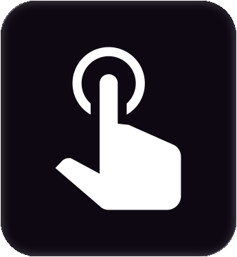
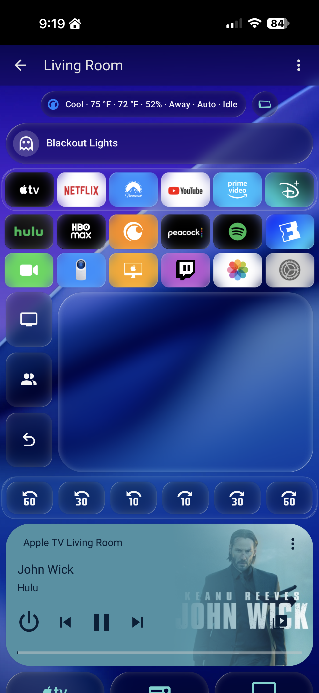
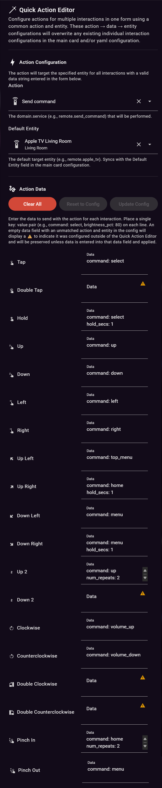
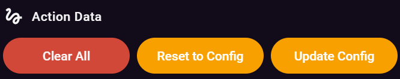
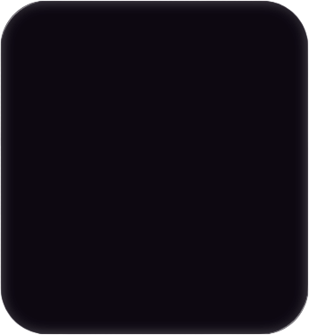
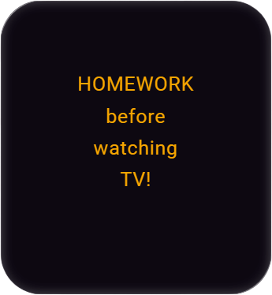
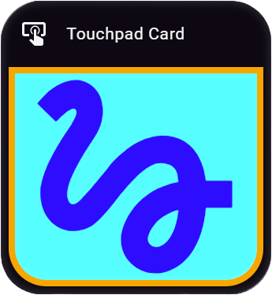

<p>
  <a href="https://github.com/GizmoGoody/touchpad-card/releases"></a>
  <a href="LICENSE"></a>
  <a href="https://hacs.xyz/"></a>
  <!-- <a href="https://github.com/GizmoGoody/touchpad-card/releases"></a> -->
</p>

<p align="center">
  
</p>

# Touchpad Card

A customizable and tunable touchpad card supporting 19 tap, linear, circular, and multi-touch interactions including continuous actions. Extensive appearance options include header, margin, border, and text, icon, and/or image overlays with dynamic text and icon support via input_text helper entities. Interaction configuration includes standard Home Assistant action editor flows and a Quick Action Editor to simplify configuration for targeting a default entity with the same action. Console logging and visual feedback are available for interaction tuning and debugging.

## Motivation and Development Status

I do not know why a standalone touchpad card does not already exist for Home Assistant. Other touchpad implementations seem good for their narrow use cases but they are embedded within cards that include other hardcoded functions - mostly focused on television control for specific brands.

This card brings out the full potential of touch control for Home Assistant:

- 🕹️ Extensive interaction support - 19 interactions should be plenty for most use cases, but if you feel the need for more, please reach out in the Discussions section ⬆️ (Hint - I already implemented and tested some and chose to leave them out 😉)
- ⚙️ Extensive action configuration and firing support - this card can be used to control your Apple TV, 3D printer, shades, or anything else that can be configured through a Home Assistant action configuration flow.
- 🧩 Compatibility with the modular and grid based approach to section layouts to which Home Assistant UI focus has shifted - Supported!

I'm not a professional developer, but I (re)learned enough JavaScript and AI prompting to create this fully functional card. I'm certain many optimizations are possible, but it's in operation for me in 3 separate rooms* and working well. I'm releasing this as a private beta to collect feedback and make any ***critical*** fixes before a more public release.

<details>
<summary>(click to expand) * This is my living room dashboard view.</summary> With the AV system off, there's a single button titled 'Watch TV' where you currently see 'Blackout Lights' leaving a clean Living Room view to control lights, etc. When I click that button, it's replaced with everything you see in this screenshot including the touchpad card and the light, etc. shift down to accommodate. Notice how seamless it integrates with the rest of the tile buttons. All tap and cardinal linear controls do what you would expect except maybe that a double-tap mutes the receiver. Circular interactions turn the volume up/down. If I double-tap before a circular interaction, I'm controlling the living room lights' brightness instead. The diagonal linear controls, two finger linear, and pinch in/out interactions are (IMO) mapped more intuitively than the Apple TV Remote itself. Of course, the two things missing that I don't know could ever be replicated in a Home Assistant remote are voice commands and a keyboard, so I tend to use this primarily and the Apple TV remote as necessary.
<p align="center">
  <br>
  <em>Quick Action Editor</em>
</p>
</details>

## Features

### Interaction Types (19 total)
- 👆 **Tap**: Single tap, double tap, and hold
- ↔️ **Linear**: Swipe in 8 directions - 4 cardinal, 4 diagonal, and 2 two-finger up/down (includes continuous action)
- 🔄 **Circular**: Clockwise and counterclockwise rotation around a center starting point (includes continuous action). Double tap and transition right into a circular interaction to fire a different action.
- 🤏 **Multi**: Pinch in and pinch out

### Appearance Customization
- 🏷️ **Header Icon and Title**: Standard
- 📏 **Margins and Borders**: Width, color, and opacity
- 🖼️ **Text, Icon, and/or Image Overlays**: Scale, color, and opacity
- ⚡ **Dynamic Content**: Text and icon overlays support dynamic `input_text` helper entities (tell your kids to do their homework before watching TV, remind yourself about the next game from your calendar, use as a family bulletin board on the overview dashboard, etc.)
- 📱 **Responsive Design**: Section and Masonry layout support

### Configuration Options
- 🎛️ **Extensive Tuning**: Fine-tune interaction sensitivity, thresholds, and timers
- 🏠 **Home Assistant Actions**: Full integration with Home Assistant action flows
- ⚡ **Quick Action Editor**: Simplified configuration for targeting a default entity with the same action - only requires the data configuration string for each interaction.
- 🐛 **Debug Features**: Console logging and visual feedback for interaction tuning and debugging

## Installation


### HACS (Custom Repository)

1. HACS ► ⋮ (menu) ► Custom repositories
2. Repository: https://github.com/GizmoGoody/touchpad-card
3. Type: Dashboard
4. HACS ► Search for "Touchpad Card" and Download
5. Reload your browser. HACS adds the dashboard resource for you.

### Manual Download
1. Download `touchpad-card.js` from the latest [release](https://github.com/GizmoGoody/touchpad-card/releases) to your Home Assistant `www` folder (create the folder if it does not exist, optionally use a subfolder)
2. Add the following to your Home Assistant resources at Settings ► Dashboards ► ⋮ (menu) ► Resources ► + Add resource
```
URL: /local/touchpad-card.js (/local is the /www folder...include subfolder path if used)
Resource type: JavaScript module
```

### Building from source
```
npm ci
npm run build
```
The built card is written to `dist/touchpad-card.js`.

## Configuration

Add the card to your dashboard by selecting Touchpad Card in the card picker.

There are three methods available to configure:

1. YAML - Edit the yaml manually. See the complete example below for all available options.

### Simple Example
```yaml
type: custom:touchpad-card # This is the only required line.
```

### Complete Example
<details>

<summary>(click to expand) This is the configuration I use to control my Living Room Apple TV, receiver, and lights</summary>

```yaml
type: custom:touchpad-card

# Layout Configuration

# Section
grid_options:
  columns: 6 # Number of columns (3-12)
  rows: 4 # Number of rows (2-12)

# Masonry 
masonry_rows: 4 # Number of rows (2-12)

# Header Configuration
header: # Header section configuration
  enabled: true # Enable header
  icon: "mdi:gesture-tap-button" # Header icon
  name: My Touchpad # Header title

# Touchpad Appearance
touchpad: # Main touchpad styling
  margin: 5 # Margin around touchpad to the card border (0-25%)
  color: cyan # Touchpad color
  opacity: 95 # Touchpad opacity (0-100%)
  
  # Border
  border: # Touchpad border styling
    width: 2 # Border width (0-25%)
    color: orange # Border color
    opacity: 80 # Border opacity (0-100%)

  # Overlay(s)
  overlay: # Text/icon/image overlays
    text: # Text
      entity: input_text.touchpad_card_text # Entity for dynamic text (supports multiline using \n line breaks)
      default: Tap to control # Static fallback text (supports multiline)
      color: white # Text color
      opacity: 75 # Text opacity (0-100%)
    graphics: # Graphics
      mode: icon # Graphics mode: "none", "icon", "image", or "both"
      icon: # Icon (mode = icon or both)
        entity: input_text.touchpad_icon # Entity for dynamic icon
        default: mdi:gesture # Static fallback icon
        scale: 120 # Icon scale (0-200%) (~120 should fill the available space since most icons have ~20% unused space around them)
        color: yellow # Icon color
        opacity: 80 # Icon opacity (0-100%)
      image: # Image (mode = image or both)
        image: "/local/my-image.png" # Path, URL, or media item picked in the editor
        scale: 100 # Image scale (0-200%)
        opacity: 50 # Image opacity (0-100%)

# Interactions
interactions:
  entity: remote.apple_tv_living_room # Default entity

  tap:

    tuning: # Tap Tuning
      timer_double: 400 # Maximum time between taps to trigger a double tap (ms)
      timer_hold: 800 # Minimum tap duration to trigger a hold (ms)

    tap_action: # Single tap
      action: perform-action # Home Assistant action type
      perform_action: remote.send_command # Action to call
      data: # Action data
        command: select
      target: # Target entity
        entity_id: remote.apple_tv_living_room
    double_tap_action: # Double tap
      action: perform-action # Home Assistant action type
      perform_action: script.mute_toggle
      target: # Target entity
        entity_id: remote.media_player.receiver_living_room
    hold_action: # Hold/long press
      action: perform-action # Home Assistant action type
      perform_action: remote.send_command
      data:
        command: select
        hold_secs: 1
      target: # Target entity
        entity_id: remote.apple_tv_living_room

  linear:

    tuning: # Linear tuning
      threshold: 30 # Minimum distance required to no longer register as a tap interaction (px)
      timer: 600 # Duration for linear interaction latching before allowing circular detection (ms)
      tolerance: 22.5 # Angle tolerance on each side of cardinal directions for diagonal recognition (degrees)
      increment: 500 # Interval between repeated linear actions after settling and holding (ms)
      settled_timer: 300 # Duration a linear must settle before starting continuous interaction firing (ms)
      settled_radius: 12 # Radius around the continuous linear settled position (px)
      # NOTE: Continuous linear actions are rate-limited by the combination of settled_timer and increment.
      # After settling, actions fire no faster than once per 'increment' ms.
      
    up_action: # Swipe up action
      action: perform-action # Home Assistant action type
      perform_action: remote.send_command # Action to call
      data: # Action data
        command: up
      target: # Target entity
        entity_id: remote.apple_tv_living_room
    down_action: # Swipe down action
      action: perform-action # Home Assistant action type
      perform_action: remote.send_command
      data:
        command: down
      target: # Target entity
        entity_id: remote.apple_tv_living_room
    left_action: # Swipe left action
      action: perform-action # Home Assistant action type
      perform_action: remote.send_command
      data:
        command: left
      target: # Target entity
        entity_id: remote.apple_tv_living_room
    right_action: # Swipe right action
      action: perform-action # Home Assistant action type
      perform_action: remote.send_command
      data:
        command: right
      target: # Target entity
        entity_id: remote.apple_tv_living_room
    up_left_action: # Diagonal swipe action
      action: perform-action # Home Assistant action type
      perform_action: remote.send_command
      data:
        command: top_menu
      target: # Target entity
        entity_id: remote.apple_tv_living_room
    up_right_action: # Diagonal swipe action
      action: perform-action # Home Assistant action type
      perform_action: remote.send_command
      data:
        command: home
        hold_secs: 1
      target: # Target entity
        entity_id: remote.apple_tv_living_room
    down_left_action: # Diagonal swipe action
      action: perform-action # Home Assistant action type
      perform_action: remote.send_command
      data:
        command: menu
      target: # Target entity
        entity_id: remote.apple_tv_living_room
    down_right_action: # Diagonal swipe action
      action: perform-action # Home Assistant action type
      perform_action: remote.send_command
      data:
        command: menu
        hold_secs: 1
      target: # Target entity
        entity_id: remote.apple_tv_living_room
    up_2_action: # Two-finger swipe up action
      action: perform-action # Home Assistant action type
      perform_action: remote.send_command
      data:
        command: up
        num_repeats: 2
        delay_secs: 0.2
      target: # Target entity
        entity_id: remote.apple_tv_living_room
    down_2_action: # Two-finger swipe down action
      action: perform-action # Home Assistant action type
      perform_action: light.toggle
      data:
        transition: 2
        brightness_pct: 50
      target: # Target entity
        entity_id:
          - light.living_room_downlights

  circular:

    tuning: # Circular tuning
      threshold_detection: 20 # Rotation required to latch a circular interaction instead of linear (degrees)
      threshold_initial: 40 # Rotation required to trigger the first circular action (degrees)
      threshold_increment: 30 # Rotation for each successive continuous circular increment (degrees)
      rate_action_max: 12.0 # Maximum action firing rate for continuous circular interactions (actions/sec)
      
    clockwise_action: # Clockwise rotation action
      action: perform-action # Home Assistant action type
      perform_action: remote.send_command # Action to call
      data: # Action data
        command: volume_up
      target: # Target entity
        entity_id: remote.apple_tv_living_room
    counterclockwise_action: # Counterclockwise rotation action
      action: perform-action # Home Assistant action type
      perform_action: remote.send_command
      data:
        command: volume_down
      target: # Target entity
        entity_id: remote.apple_tv_living_room
    double_clockwise_action: # Double tap + clockwise rotation action
      action: perform-action # Home Assistant action type
      perform_action: light.turn_on
      data:
        brightness_step_pct: 2
      target: # Target entity
        entity_id:
          - light.living_room_downlights
    double_counterclockwise_action: # Double tap + counterclockwise rotation action
      action: perform-action # Home Assistant action type
      perform_action: light.turn_on
      data:
        brightness_step_pct: -2
      target: # Target entity
        entity_id:
          - light.living_room_downlights

  multi:

    tuning: # Multi-touch tuning
      timer: 200 # Duration for multi-touch interactions between first and last touches (ms)
      threshold: 50 # Minimum distance change between two pointers to recognize pinch (px)
      ratio: 2.0 # Ratio threshold for determining dominant interaction type when both pinch and linear occur (ratio)
      
    pinch_in_action: # Pinch in (zoom out)
      action: perform-action # Home Assistant action type
      perform_action: remote.send_command # Action to call
      data:
        command: home
        num_repeats: 2
        delay_secs: 0.2
      target: # Target entity
        entity_id: remote.apple_tv_living_room
    pinch_out_action: # Pinch out (zoom in)
      action: perform-action # Home Assistant action type
      perform_action: remote.send_command
      data:
        command: menu
      target: # Target entity
        entity_id: remote.apple_tv_living_room

  debugging: # Tuning and Development

    logging: false # Enable interaction console logging
    feedback: false # Enable visual feedback on card for recognized interactions. Displays total interaction increments and the rate limited actions fired with a real-time indicition if the user is exceeding the rate limit.

```

</details>

<br>

2. Visual Editor - Consistent with current Home Assistant card configuration UX. Extensive helper text is offered throughout - especially in the tuning sections.
<br>

3. Quick Action Editor - For interactions which will target the same default entity with the same action, this consolidated form allows the user to enter that default entity and action once, then only specify the data configuration string for each interaction.

<details>

<summary>(click to expand) This is the Quick Action Editor configuration I use to control my Living Room Apple TV. Since the Apple TV is the primary entity I control with this touchpad card, I've set it as the default entity. Notice that the four interactions which control the receiver and lights instead are indicated with a ⚠️. When hovering over that icon, the current configuration for that interaction displays.</summary>
<p align="center">
  <br>
  <em>Quick Action Editor</em>
</p>

</details>

<br>

<p><strong>NOTE</strong> - Changes made in the Quick Action Editor <strong>DO NOT</strong> auto-save. You must click  to commit your changes to the configuration.</p>

<p align="center">
  <br>
  <em>Quick Action Editor Buttons</em>
</p>

## Appearance Examples

<p align="center">
  <br>
  <em>Clean and minimal</em>
</p>

<p align="center">
  <br>
  <em>Text overlay</em>
</p>

<p align="center">
  <br>
  <em>Header, margin, border, and icon overlay</em>
</p>

## Contributions

This project is in active development on a time-available basis. Contributions are welcome for:

- 🐞 Bug fixes
- ⚡ Performance optimizations
- 🧩 Shadow DOM implementation following Home Assistant guidelines
- 🧹 CSS cleanup and standardization
- 🎨 Card level theme support
- 📝 Documentation improvements
- ✨ Feature enhancements
- 💡 ANY OTHER IMPROVEMENTS YOU SEE
## FAQ

- Why aren’t actions firing continuously when I rotate or hold a linear interaction?
  - Continuous interactions are rate‑limited to prevent flooding. For linear, actions fire no faster than once per `increment` after the `settled_timer`. For circular, actions fire with each angular increment except when capped by `rate_action_max` (actions/sec).

- Does the overlay text support multiple lines?
  - Yes. While it should only be necessary for the `input_text` entity, the card converts the literal sequence "\n" to a line break.

- Can I use animated GIFs for the overlay image?
  - Yes.

- The card size in Masonry layout looks too big/small.
  - Adjust `masonry_rows`.

- I don’t see the card in the card picker.
  - Ensure the resource is added at Settings ► Dashboards ► Resources, clear browser cache (hard reload), and confirm the `type: custom:touchpad-card` in YAML.

- My `input_text` icon does not show.
  - Make sure the state is a valid icon that works in other icon fields within Home Assistant. (e.g., `mdi:<>', etc.).